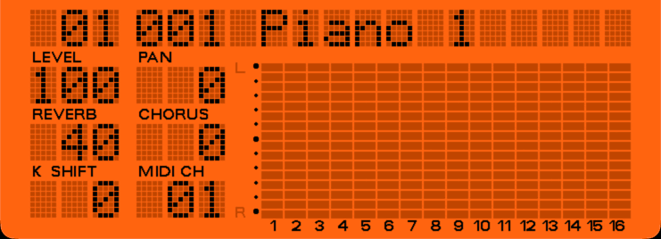

# scgfx

scgfx is a tool for working with Roland Sound Canvas graphics data.

Introduced with the original SC-55 in 1991, Roland defined 'display data' via system exclusive messages (SysEx), that allows for 16x16 images to be displayed on the Sound Canvas display. In addition, text could also be displayed in the instrument name area of the display.

This was then expanded in 1994 with the SC-88 to allow 10 different images to be stored and recalled at random via the 'display pages' feature.

Whilst creating this tool, I also discovered a hidden image transfer mode on the SC-88, which allows for 'delta' frame updates to be sent to the device - only pixels that are changed are transmitted instead of transmitting full frames.

## Features

* Encoding and decoding of graphics data to/from MIDI/PBM/TXT
* Ability to generate MIDI files with graphics data only
* Ability to merge graphics data with existing MIDI file
* Ability to encode graphics data to a separate track (format 0 and 1 MIDI) without disturbing existing MIDI data
* Ability to interleave graphics data into a format 0 MIDI file; this is ideal for older MIDI playback devices, such as the Sound Brush SB-55 that do not buffer the file before playback
* Delta encoding (SC-88+ only) - sends only changed pixels rather than full frames, which can greatly reduce file size. scgfx also does a comparison to automatically determine the optimal method to use.
* Simple command line operation
* Additionally, a full scripting language that allows for creation of advanced projects which can include custom defined graphics, loops, videos, and text tracks.
* Finally, a small tool called genscroll is included that generates scrolling text image frames. If run interactively it will ask for an input. Alternatively, the string to encode can be specified on the command line. By default text will be rendered scrolling horizontally one pixel at a time. The command line switch -step <x> can be used to change to to scroll <x> pixels each frame. -speed does the same thing.

## Usage
Build it. Run it - the instructions are self explanatory. Samples are included.

## The big dirty secret

I didn't write any of this. Other than this readme, scgfx is the result of me discussing and testing out various things with ChatGPT. This was created merely by providing ChatGPT with a copy of the 'Star Games' demo MIDI file that Roland provided with the SC-55 - this was converted to CSV with the excellent csvmidi tool and then uploaded to ChatGPT. After running some tests to determine how each pixel is addressed, a basic proof of concept was created.

It wasn't until quite late into the project that I realised that the Sound Canvas manuals actually described the display data SysEx, as well as the text display. Finally, the page data information was implemented based on the information provided in the SC-88 manual.

scgfx is already at v3.0 as it went from a small C program that could encode a folder of images to what it is now, split out into multiple modules.

I have written zero lines of code. The extent of my input has been tweaking the instructions displayed when run.

## Other miscellaneous notes

### SC-88 pages
Once you send multiple pages to the SC-88, future updates to page 1 (i.e. the normal display data used on the SC-55, and where animation frames are sent to) will not display. To clear page data to allow page 1 to display when updated, just put the unit into standby, then power it back on.

### 'Delta' frame updates
Delta frame updates reduces the amount of MIDI data required by transmitting only the portions of the display that have changed since the previous frame. Rather than simply sending every changed byte individually, scgfx analyses each frame and chooses the most efficient representation. If a single contiguous delta update is smaller than sending the entire 64-byte framebuffer, it emits a partial DT1 update; otherwise it automatically falls back to a full framebuffer write. Frames that are identical to the previous frame are omitted entirely. This approach minimises MIDI bandwidth while avoiding cases where multiple small SysEx messages would actually be larger than a single full-frame update.

Because unchanged frames are omitted, the original animation timing can no longer be determined from the MIDI data alone. To solve this, scgfx embeds a small metadata block containing the original animation parameters, allowing the exact sequence of frames to be reconstructed during decoding. The metadata is stored as a standard MIDI text event, making it completely inert and ignored by MIDI playback devices.

This functionality is not documented by Roland anywhere and was discovered during testing - it has been tested on the SC-88VL, but does not work on the SC-55 or SC55mkII.

## Device compatibility matrix

| Device | Supports display data? | Supports page data? | Supports 'delta display updates'? |
|--------|:-----------------------:|:-------------------:|:---------------------------------:|
| Roland SC-33 | N | N | N |
| Roland SC-55 | Y | N | N |
| Roland SC-55 mkII | Y | N | N |
| Roland SC-88VL | Y | Y | Y |
| YAMAHA MU15 | Y* | N | N |
| YAMAHA MU80 | Y | N | N |
| YAMAHA MU100R | Y* | N | N |

\* Device must be in **TG300B mode**.
